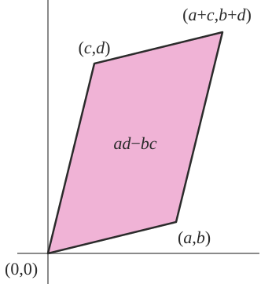

{:toc}

# linear basics

## notation

- $x \preceq y$ - these are vectors and x is less than y elementwise
- $X \preceq Y$ - matrices, $Y-X$ is PSD
  - $$v^TXv \leq v^TYv \:\: \forall v$$<!-- -->

## linearity

- inner product $$<X, Y> = \operatorname{tr}(X^TY) = \sum_i \sum_j X_{ij} Y_{ij}$$
  - like inner product if we collapsed into big vector
  - linear
  - symmetric
  - gives angle back
- linear
    1. superposition $f(x+y) =  f(x)+f(y) $
    2. proportionality $f(k\cdot x) = k \cdot f(x)$
- bilinear just means a function is linear in 2 variables
- vector space
    1. closed under addition
    2. contains identity
- det - sum of products including one element from each row / column with correct sign
  - absolute value = area of parallelogram made by rows (or cols)
  - 
- lin independent: $c_1x_1+c_2x_2=0 \implies c_1=c_2=0$
- *cauchy-schwartz inequality*: $$\vert x^T y\vert  \leq \vert \vert x\vert \vert _2 \vert \vert y\vert \vert \vert _2$$
  - implies *triangle inequality*: $$\vert \vert x+y\vert \vert ^2 \leq (\vert \vert x\vert \vert  + \vert \vert y\vert \vert )^2$$

## matrix properties

- $x^TAx = \operatorname{tr}(xx^TA)$
- *nonsingular* = invertible = nonzero determinant = null space of zero
  - only square matrices
  - *rank* of mxn matrix- max number of linearly independent columns / rows
    - rank==m==n, then nonsingular
  - *ill-conditioned matrix* - matrix is close to being singular - very small determinant
- inverse
  - *orthogonal matrix*: all columns are *orthonormal*
    - $A^{-1} = A^T$
    - preserves the Euclidean norm $$\vert \vert Ax\vert \vert _2 = \vert \vert x\vert \vert _2$$
  - if diagonal, inverse is invert all elements
  - inverting 3x3 - transpose, find all mini dets, multiply by signs, divide by det
  - *psuedo-inverse* = *Moore-Penrose inverse* $A^\dagger = (A^T A)^{-1} A^T$
    - if A is nonsingular, $A^\dagger = A^{-1}$
    - if rank(A) = m, then must invert using $A A^T$
    - if rank(A) = n, then must use $A^T A$
  - inversion of matrix is $\approx O(n^3)$
  - inverse of psd symmetric matrix is also psd and symmetric
  - if A, B invertible $(AB)^{-1} = B^{-1} A^{-1}$
- *orthogonal complement* - set of orthogonal vectors
  - define R(A) to be *range space* of A (column space) and N(A) to be *null space* of A
  - R(A) and N(A) are orthogonal complements
  - dim $R(A)$ = r
  - dim $N(A)$ = n-r
  - dim $R(A^T)$ = r
  - dim $N(A^T)$ = m-r
- *adjoint* - compute with mini-dets
  - $A^{-1} = adj(A) / \det(A)$
- *Schur complement* of $$X = \begin{bmatrix}  A & B \\  C & D\end{bmatrix}$$
  - $M/D = A - BD^{-1}C$
  - $M/A = D-CA^{-1}B$
  - $X \succeq 0 \iff M/D \succeq 0$

# matrix calc

- overview: imagine derivative $f(x + \Delta)$
- function f: $\text{anything} \to \mathbb{R}^m$
  - *gradient* vector $\nabla_A f(\mathbf{A})$- partial derivatives with respect to each element of A (vector or matrix)
  - gradient = $\frac{\partial f}{\partial A}^T$
- these next 2 assume numerator layout (numerator-major order, so numerator constant along rows)
- function f: $\mathbb{R}^n \to \mathbb{R}^m$
  - **Jacobian matrix**: $$\mathbf J = \begin{bmatrix}    \dfrac{\partial \mathbf{f}}{\partial x_1} & \cdots & \dfrac{\partial \mathbf{f}}{\partial x_n} \end{bmatrix}= \begin{bmatrix}    \dfrac{\partial f_1}{\partial x_1} & \cdots & \dfrac{\partial f_1}{\partial x_n}\\   \vdots & \ddots & \vdots\\    \dfrac{\partial f_m}{\partial x_1} & \cdots & \dfrac{\partial f_m}{\partial x_n} \end{bmatrix}$$ - this is dim(f) x dim(x)
- function f: $\mathbb{R}^n \to \mathbb{R}$
  - 2nd derivative is **Hessian matrix**
    - $$\bold H = \nabla^2 f(x)_{ij} = \frac{\partial^2 f(x)}{\partial x_i \partial x_j} = \begin{bmatrix}  \dfrac{\partial^2 f}{\partial x_1^2} & \dfrac{\partial^2 f}{\partial x_1\,\partial x_2} & \cdots & \dfrac{\partial^2 f}{\partial x_1\,\partial x_n} \\[2.2ex]  \dfrac{\partial^2 f}{\partial x_2\,\partial x_1} & \dfrac{\partial^2 f}{\partial x_2^2} & \cdots & \dfrac{\partial^2 f}{\partial x_2\,\partial x_n} \\[2.2ex]  \vdots & \vdots & \ddots & \vdots \\[2.2ex]  \dfrac{\partial^2 f}{\partial x_n\,\partial x_1} & \dfrac{\partial^2 f}{\partial x_n\,\partial x_2} & \cdots & \dfrac{\partial^2 f}{\partial x_n^2}\end{bmatrix}$$<!-- -->
- examples
  - $\nabla_x a^T x = a$
  - $\nabla_x x^TAx = 2Ax$ (if A symmetric, else $(A+A^T)x)$)
  - $\nabla_x^2 x^TAx = 2A$ (if A symmetric, else $A+A^T$)
  - $$\nabla_x \log \: \det X = X^{-1}$$<!-- -->
- we can calculate derivs of quadratic forms by calculating derivs of traces
  - $x^TAx = \operatorname{tr}[x^TAx] = \operatorname{tr}[xx^TA]$
  - $\implies \frac{\partial}{\partial A} x^TAx = \frac{\partial}{\partial A} \operatorname{tr}[xx^TA] = [xx^T]^T = xx^T$
  - useful result: $$\frac{\partial}{\partial A} \log\vert A\vert  = A^{-T}$$

# norms

- def
  1. nonnegative
  2. definite f(x) = 0 iff x = 0
  3. proportionality (also called homogenous)
  4. triangle inequality
- properties
  - convex

## vector norms

- **$L_p-$norms**: $$\vert \vert x\vert \vert _p = (\sum_{i=1}^n \vert x_i\vert ^p)^{1/p}$$
  - $L_0$ norm - number of nonzero elements (this is not actually a norm!)
  - $$\vert \vert x\vert \vert _1 = \sum \vert x_i\vert $$<!-- -->
  - $$\vert \vert x\vert \vert _2$$ - Euclidean norm
  - $$\vert \vert x\vert \vert _\infty = \max_i \vert x_i\vert $$ - also called *Cheybyshev norm*
- *quadratic norms*
  - *P-quadratic norm*: $$\vert \vert x\vert \vert _P = (x^TPx)^{1/2} = \vert \vert  P^{1/2} x \vert \vert _2$$ where $$P \in S_{++}^n$$
- *dual norm*
  - given a norm $$\vert \vert  \cdot \vert \vert $$, dual norm $$\vert \vert z\vert \vert _* = \sup\{ z^Tx \: \vert  \: \vert \vert x\vert \vert  \leq 1\}$$
  - dual of the dual is the original
  - dual of Euclidean is just Euclidean
  - dual of $l_1$ is $l_\infty$
  - dual of spectral norm is some of the singular values

## matrix norms

- schatten p-norms: $$\vert \vert X\vert \vert _p = (\sum \sigma^p_i(A) )^{1/p}$$ - note this is nice for organization but this p is never really mentioned
  - p=1: **nuclear norm** = **trace norm**: $$\vert \vert X\vert \vert _* = \sum_i \sigma_i$$
  - p=2: **frobenius norm** = **euclidean norm**: $$\vert \vert X\vert \vert _F^2 = \sqrt {\sum_{ij} X_{ij}^2} = \sqrt{\sum_i \sigma_i^2}$$
  - like vector $L_2$ norm
  - p=$\infty$: **spectral norm** = **$\mathbf{L_2}$-norm** (of a matrix) = $$\vert \vert X\vert \vert _2 = \sigma_\text{max}(X) $$
- entrywise norms
  - sum-absolute-value norm (like vector $l_1$)
  - maximum-absolute-value norm (like vector $l_\infty$)
- *operator norm*
  - let $$\vert \vert \cdot\vert \vert _a$$ and $$\vert \vert  \cdot \vert \vert _b$$ be vector norms
  - operator norm $$\vert \vert X\vert \vert _{a,b} = \sup\{ \vert \vert Xu\vert \vert _a \: \vert  \: \vert \vert u\vert \vert _b \leq 1 \}$$
    - represents the maximum stretching that X does to a vector u
  - if using p-norms, can get Frobenius and some others

# eigenstuff

## eigenvalues intro - Strang 5.1

- [nice viz](http://setosa.io/ev/eigenvectors-and-eigenvalues/)
- elimination changes eigenvalues
- eigenvector application to diff eqs $\frac{du}{dt}=Au$
  - soln is exponential: $u(t) = c_1 e^{\lambda_1 t} x_1 + c_2 e^{\lambda_2 t} x_2$
- *eigenvalue eqn*: $Ax = \lambda x \implies (A-\lambda I)x=0$
  - $\det(A-\lambda I) = 0$ yields *characteristic polynomial*
- eigenvalue properties
  - 0 eigenvalue $\implies$ A is singular
  - eigenvalues are on the main diagonal when the matrix is triangular
- expressions when $A \in \mathbb{S}$
  - $\det(A) = \prod_i \lambda_i$
  - $\operatorname{tr}(A) = \sum_i \lambda_i$
  - $$\vert \vert A\vert \vert _2 = \max \vert  \lambda_i \vert $$<!-- -->
  - $$\vert \vert A\vert \vert _F = \sqrt{\sum \lambda_i^2}$$<!-- -->
  - $\lambda_{\max} (A) = \sup_{x \neq 0} \frac{x^T A x}{x^T x}$
  - $\lambda_{\min} (A) = \inf_{x \neq 0} \frac{x^T A x}{x^T x}$
- *defective matrices* - lack a full set of eigenvalues
- *positive semi-definite*: $A \in R^{nxn}$
  - basically these are always *symmetric* $A=A^T$
  - all eigenvalues are nonnegative
  - if $\forall x \in R^n, x^TAx \geq 0$ then A is positive semi definite (PSD)
    - like it curves up
    - Note: $x^TAx = \sum_{i, j} x_iA_{i, j} x_j$
  - if $\forall x \in R^n, x^TAx > 0$ then A is positive definite (PD)
    - PD $\to$ full rank, invertible
  - PSD + symmetric $\implies$ can be written as *Gram matrix* $G = X^T X $
    - if X full rank, then $G$ is PD
  - PSD notation
    - $S^n$ - set of symmetric matrices
    - $S^n_+$ - set of PSD matrices
    - $S^n_{++}$ - set of PD matrices

## Strang 5.2 - diagonalization

- *diagonalization* = *eigenvalue decomposition* = *spectral decomposition*
- assume A (nxn) is symmetric
  - $A = \cblue{Q} \corange{\Lambda} \cblue{Q^T}$
  - Q := eigenvectors as columns, Q is orthonormal
  - $\Lambda$ := eigenvalues on diagonal
- only diagonalizable if n independent eigenvectors
  - not related to invertibility
  - eigenvectors corresponding to different eigenvalues are lin. independent
  - other Q matrices won't produce diagonal
  - there are always n complex eigenvalues
  - orthogonal matrix $Q^TQ=I$
- examples
  - if X, Y symmetric, $\operatorname{tr}(YX) = \operatorname{tr}(Y \sum \lambda_i q_i q_i^T)$
  - lets us easily calculate $A^2$, $\sqrt{A}$
  - eigenvalues of $A^2$ are squared, eigenvectors remain same
  - eigenvalues of $A^{-1}$ are inverse eigenvalues
  - eigenvalue of rotation matrix is $i$
- eigenvalues for $AB$ only multiply when A and B share eigenvectors
  - diagonalizable matrices *share the same eigenvector* matrix S iff $AB = BA$
- *generalized eigenvalue decomposition* - for 2 symmetric matrices
  - $A = V \Lambda V^T$, $B=VV^T$

## Strang 6.3 - singular value decomposition

- SVD for any nxp matrix: $X=\cblue{U} \corange{\Sigma} \cgreen{V^T}$
  - U columns (nxn) are eigenvectors of $XX^T$
  - columns of V (pxp) are eigenvectors of $X^TX$
  - r singular values on diagonal of $\corange{\Sigma}$ (nxp) - square roots of nonzero eigenvalues of both $XX^T$ and $X^TX$
  - like rotating, scaling, and rotating back
  - SVD ex. $A=UDV^T \implies A^{-1} = VD^{-1} U^T$
  - $X = \sum_i \sigma_i u_i v_i^T$
- properties
  1. for PD matrices, $\Sigma=\Lambda$, $U\Sigma V^T = Q \Lambda Q^T$
  - for other symmetric matrices, any negative eigenvalues in $\Lambda$ become positive in $\Sigma$
- applications
  - very numerically stable because U and V are orthogonal matrices
  - *condition number* of invertible nxn matrix = $\sigma_{\max} / \sigma_{\min}$
  - $$A=\cblue{U}\corange{\Sigma} \cgreen{V^T} = \cblue{u_1} \corange{\sigma_1} \cgreen{v_1^T} + ... + \cblue{u_r} \corange{\sigma_r} \cgreen{v_r^T}$$<!-- -->
    - we can throw away columns corresponding to small $\corange{\sigma_i}$
  - pseudoinverse $A^+ = V \Sigma^+ U^T$

## Strang 5.3 - difference eqs and power $A^k$

- compound interest
- solving for fibonacci numbers
- Markov matrices
  - steady-state Ax = x
  - corresponds to $\lambda = 1$
- stability of $u_{k+1} = A u_k$
  - stable if all eigenvalues satisfy $$\vert \lambda_i\vert $$ <1
  - neutrally stable if some $$\vert \lambda_i\vert =1$$
  - unstable if at least one $$\vert \lambda_i\vert $$ > 1
- Leontief's input-output matrix
- **Perron-Frobenius thm** - if A is a positive matrix (positive values), so is its largest eigenvalue and every component of the corresponding eigenvector is also positive
  - useful for ranking, etc.
- **power method**: want to find eigenvector $v$ corresponding to largest eigenvalue
  - $$v = \underset{n \to \infty}{\lim} \frac{A^n v_0}{\vert A^nv_0\vert }$$ where $v_0$ is nonnegative
