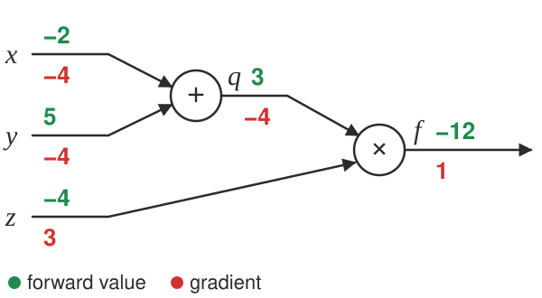
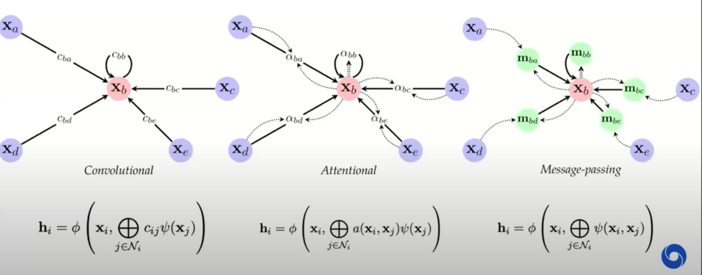

{:toc}

See also notes in [📌 unsupervised learning](https://csinva.io/notes/ml/unsupervised.html), [📌 disentanglement](https://csinva.io/notes/research_ovws/ovw_disentanglement.html), [📌 nlp](https://csinva.io/notes/ml/nlp.html), [📌 transformers](https://csinva.io/notes/research_ovws/ovw_llms.html)

# basics

- basic perceptron update rule
    - if output is 0, label is 1: increase active weights
    - if output is 1, label is 0: decrease active weights
- *perceptron convergence thm* - if data is linearly separable, perceptron learning algorithm wiil converge
- transfer / activation functions
    - sigmoid(z) = $\frac{1}{1+e^{-x}} = \frac{e^x}{e^x+1}$
    - Binary step
    - TanH (preferred to sigmoid)
    - Rectifier = ReLU
         - Leaky ReLU - still has some negative slope when <0
         - rectifying in electronics converts analog -> digital
    - rare to mix and match neuron types
- *deep* - more than 1 hidden layer
- mean-squared error (regression loss) = $\frac{1}{2}(y-\hat{y})^2$
- cross-entropy loss (classification loss) = $=-\sum_j y_j \ln \hat{p}_j$
    - for binary classification, $y_j$ would take on 0 or 1 and $\hat y_j$ would be a probability
- **backpropagation** - application of *reverse mode automatic differentiation* to neural networks's loss
  - apply the chain rule from the end of the program back towards the beginning
    - $\frac{dL}{d \theta_i} = \frac{dL}{dz} \frac{\partial z}{\partial \theta_i}$
    - sum $\frac{dL}{dz}$ if neuron has multiple outputs z
    - L is output
  - $\frac{\partial z}{\partial \theta_i}$ is actually a Jacobian (deriv each $z_i$ wrt each $\theta_i$ - these are vectors)
    - each gate usually has some sparsity structure so you don't compute whole Jacobian
- pipeline
  - initialize weights, and final derivative ($\frac{dL}{dL}=1$)
  - for each batch
    - run network forward to compute outputs at each step
    - compute gradients at each gate with backprop
    - update weights with SGD

# some historical popular nets

- early CNNs - LeNet ([lecun et al. 1998](http://yann.lecun.com/exdb/publis/pdf/lecun-01a.pdf)): first, used on MNIST; AlexNet ([krizhevsky et al. 2012](https://papers.nips.cc/paper/2012/hash/c399862d3b9d6b76c8436e924a68c45b-Abstract.html)): 5 conv layers, some pooling/dropout; ZFNet ([zeiler & fergus 2013](https://arxiv.org/abs/1311.2901)): fine-tuning and deconvnet; VGGNet ([simonyan & zisserman 2014](https://arxiv.org/abs/1409.1556)): 19 layers, all 3x3 conv and 2x2 max pooling
- deeper nets - GoogLeNet ([szegedy et al. 2015](https://arxiv.org/abs/1409.4842)): lots of parallel elements (Inception module); ResNet ([he et al. 2015](https://arxiv.org/abs/1512.03385)): 152 layers, connections straight from initial layers to the end, only learns the "residual"; DenseNet ([huang et al. 2016](https://arxiv.org/abs/1608.06993))
- efficient / searched architectures - SqueezeNet ([iandola et al. 2016](https://arxiv.org/abs/1602.07360)), NASNet ([zoph et al. 2017](https://arxiv.org/abs/1707.07012)), EfficientNet ([tan & le 2019](https://arxiv.org/pdf/1905.11946.pdf))
- object detection - R-CNN ([girshick et al. 2013](https://arxiv.org/abs/1311.2524)), Fast R-CNN ([girshick 2015](https://arxiv.org/abs/1504.08083)), Faster R-CNN ([ren et al. 2015](https://arxiv.org/abs/1506.01497)), YOLO ([redmon et al. 2015](https://arxiv.org/abs/1506.02640))
- segmentation - SegNet ([badrinarayanan et al. 2015](https://arxiv.org/abs/1511.00561)): encoder-decoder; U-Net ([ronneberger et al. 2015](https://arxiv.org/abs/1505.04597)): biomedical; PixelNet ([bansal et al. 2017](https://arxiv.org/abs/1702.06506)): pixel-level predictions for different tasks with the same architecture (conv layers, then 3 FC layers that use outputs from all conv layers together)
- other - image descriptions with RNN+CNN ([karpathy & fei-fei 2014](https://arxiv.org/abs/1412.2306)); spatial transformer networks ([jaderberg et al. 2015](https://arxiv.org/abs/1506.02025)): transformations within the network; WaveNet ([van den oord et al. 2016](https://arxiv.org/abs/1609.03499))

# CNNs

- kernel here means filter
- convolution G- takes a windowed average of an image F with a filter H where the filter is flipped horizontally and vertically before being applied
- G = H $\ast$ F
    - if we do a filter with just a 1 in the middle, we get the exact same image
    - you can basically always pad with zeros as long as you keep 1 in middle
    - can use these to detect edges with small convolutions
    - can do Guassian filters
- 1st-layer convolution typically sum over all color channels
- 1x1 conv - still convolves over channels
- pooling - usually max - doesn't pool over depth
  - people trying to move away from this - larger strides in conversation layers
  - stacking small layers is generally better
- most of memory impact is usually from activations from each layer kept around for backdrop
- visualizations
    - layer activations (maybe average over channels)
    - visualize the weights (maybe average over channels)v
    - feed a bunch of images and keep track of which activate a neuron most
    - t-SNE embedding of images
    - occluding
- weight matrices have special structure (Toeplitz or block Toeplitz)
- input layer is usually centered (subtract mean over training set)
- usually crop to fixed size (square input)
- receptive field - input region
- stride m - compute only every mth pixel
- downsampling
    - max pooling - backprop error back to neuron w/ max value
    - average pooling - backprop splits error equally among input neurons
- data augmentation - random rotations, flips, shifts, recolorings
- siamese networks - extract features twice with same net then put layer on top
    - ex. find how similar to representations are

# RNNs

- feedforward NNs have no memory so we introduce recurrent NNs
- able to have memory
- truncated - limit number of times you unfold
- $state_{new} = f(state_{old},input_t)$
- ex. $h_t = tanh(W h_{t-1}+W_2 x_t)$
- train with backpropagation through time (unfold through time)
  - truncated backprop through time - only run every k time steps
- error gradients vanish exponentially quickly with time lag
- **LSTMS**
  - have gates for forgetting, input, output
  - easy to let hidden state flow through time, unchanged
  - gate $\sigma$ - pointwise multiplication
    - multiply by 0 - let nothing through
    - multiply by 1 - let everything through
  - forget gate - conditionally discard previously remembered info
  - input gate - conditionally remember new info
  - output gate - conditionally output a relevant part of memory
  - GRUs - similar, merge input / forget units into a single update unit

# misc architectural components

- **coordconv** - break translation equivariance by passing in i, j coords as extra filters
- **deconvolution** = transposed convolution = fractionally-strided convolution - like upsampling

## graph neural networks

- [Theoretical Foundations of Graph Neural Networks](https://www.youtube.com/watch?v=uF53xsT7mjc)
  - inputs are graphs
  - e.g. molecule input to classification
    - one big study: a deep learning appraoch to antibiotic discovery ([stokes et al. 2020](https://www.sciencedirect.com/science/article/pii/S0092867420301021)) - using GNN classification of antibiotic resistance, came up with 100 candidate antibiotics and were able to test them
  - e.g. traffic maps - nodes are intersections
  - invariances in CNNs: translational, neighbor pixels relate a lot more
  - simplest setup: no edges, each node $i$ has a feature vector $x_i$ (really a set not a graph)
    - X is a matrix where each row is a feature vector
    - note that permuting rows of X shouldn't change anything
    - **permutation invariant**: $f(PX) = f(X)$ for all permutation matrices $P$
      - e.g. $$\mathbf{P}_{(2,4,1,3)} \mathbf{X}=\left[\begin{array}{llll}0 & 1 & 0 & 0 \\ 0 & 0 & 0 & 1 \\ 1 & 0 & 0 & 0 \\ 0 & 0 & 1 & 0\end{array}\right]\left[\begin{array}{lll}- & \mathbf{x}_{1} & - \\ - & \mathbf{x}_{2} & - \\ - & \mathbf{x}_{3} & - \\ - & \mathbf{x}_{4} & -\end{array}\right]=\left[\begin{array}{lll}- & \mathbf{x}_{2} & - \\ - & \mathbf{x}_{4} & - \\ - & \mathbf{x}_{1} & - \\ - & \mathbf{x}_{3} & -\end{array}\right]$$
      - ex. *Deep Sets* model (zaheer et al. '17): $f(X) = \phi \left (\sum_k \psi(x_i) \right)$
    - **permutation equivariant**: $f(PX) = P f(X)$ - useful for when we want answers at the node level
  - graph: augment set of nodes with edges between them (store as an adjacency matrix)
    - permuting permutation matrix to A requires operating on both rows and cols: $PAP^T$
    - permutation invariance: $ f\left(\mathbf{P X}, \mathbf{P A P}^{\top}\right)=f(\mathbf{X}, \mathbf{A})$
    - permutation equivariance: $f\left(\mathbf{P X}, \mathbf{P A P}^{\top}\right)=\mathbf{P} f(\mathbf{X}, \mathbf{A})$
    - can now write an equivariant function that extracts features not only of X, but also its neighbors: $g(x_b, X_{\mathcal N_b})$
      - tasks: node classification, graph classification, link (edge) prediction)
    - 3 flavors of GNN layers for extracting features from nodes / neighbors: simplest to most complex
      - message-passing actually passes vectors to be sent across edges
      - 
  - previous approaches map on to gnns well
    - GNNs explicitly construct local features, much like previous works
      - local objectives: features of nodes i and j should predict existence of edge $(i, j)$
      - random-walk objectives: features should be similar if i and j co-occur on a short random walk (e.g. deepwalk, node2vec, line)
    - similarities to NLP if we think of words as nodes and sentences as walks
      - we can think of transformers as fully-connect graph networks with attentional form of GNN layers
        - one big difference: positional embeddings often used, making the input not clearly a graph
          - these postitional embeddings often take the form of sin/cos - very similar to DFT eigenvectors of a graph
    - spectral gnns
      - operate on graph laplacian matrix $L = D - A$ where $D$ is degree matrix and $A$ is adjacency matrix - more mathematically convenient
    - probabilistic modeling - e.g. assome markov random field and try to learn parameters
      - this connects well to a message-passing GNN
- GNN limitations
  - ex. can we tell whether 2 graphs are isomorphic - often no?
  - can make GNNs more powerful by adding positional features, etc.
  - can also embed sugraphs together
  - continuous case is more difficult
- geometric deep learning: invariances and equivariances can be applied generally to get a large calss of architectures between convolutions and graphs

## top-down feedback

- Look and Think Twice: Capturing Top-Down Visual Attention With Feedback Convolutional Neural Networks ([2015](https://openaccess.thecvf.com/content_iccv_2015/html/Cao_Look_and_Think_ICCV_2015_paper.html))
    - neurons in the feedback hidden layers update their activation status to maximize the confidence output of the target top neuron
- Top-Down Neural Attention by Excitation Backprop ([2017](https://link.springer.com/article/10.1007/s11263-017-1059-x))
    - top-down attention maps by extending winner-take-all (WTA) to probabilistic maps
    - Modeling visual attention via selective tuning ([1995](https://www.sciencedirect.com/science/article/pii/0004370295000259))
        - original WTA paper provides only binary maps
- Bottom-Up and Top-Down Reasoning with Hierarchical Rectified Gaussians ([2016](https://arxiv.org/abs/1507.05699))
- Beyond Skip Connections: Top-Down Modulation for Object Detection ([shrivastava…malik, gupta, 2017](https://arxiv.org/abs/1612.06851))
- Learning to Combine Top-Down and Bottom-Up Signals in Recurrent Neural Networks with Attention over Modules ([mittal…bengio, 2020](http://proceedings.mlr.press/v119/mittal20a.html))
    - Very similar — each layer passes attention (1) to next layer (2) to itself (3) to previous layer
    - Fast and Slow Learning of Recurrent Independent Mechanisms ([madan…bengio, 2021](https://arxiv.org/abs/2105.08710))
    - Inductive Biases for Deep Learning of Higher-Level Cognition ([goyal & bengio, 2021](https://arxiv.org/abs/2011.15091))
- Neural Networks with Recurrent Generative Feedback ([huang…tsao, anandkumar, 2020](https://proceedings.neurips.cc/paper/2020/hash/0660895c22f8a14eb039bfb9beb0778f-Abstract.html))
    - Deconvolutional Generative Model ([nguyen et al. 2018](https://arxiv.org/abs/1811.02657)) DGM - hierarchical latent variables capture variation in images + generate images from a coarse to fine detail using deconvolution operations
- A generative vision model that trains with high data efficiency and breaks text-based CAPTCHAs ([vicarious, 2016](https://www.science.org/doi/full/10.1126/science.aag2612?casa_token=dXK8WGm0t04AAAAA%3ArHcvkJAn4ornLgAxVmjXS_NbVTW7HSvyJVTFuJVgYmq7LYD39noT5W0l-34piGa9R-sFC37wuEF5u1jb))
    - bayesian model + crf on latents breaks captchas
- Combining Top-Down and Bottom-Up Segmentation ([2008](https://www.msri.org/people/members/eranb/Combining_td_and_bu.pdf)) (pre-DNNs)
    - Bottom-up segmentation: group chunks of image into ever-larger regions based on e.g. texture similarity
    - Top-down segmentation: find object boundaries based on label info
- Perceiver: General Perception with Iterative Attention ([2021](https://arxiv.org/abs/2103.03206))
- Integration of top-down and bottom-up visual processing using a recurrent convolutional–deconvolutional neural network for semantic segmentation ([2019](https://link.springer.com/article/10.1007/s11370-019-00296-5))
    - Very similar to our idea - they have deconvolved feedback to earlier layers
    - Architecture’s weird, tho - feedback only goes back a few layers
    - Extremely applied - their result is “we beat SOTA by 3%”
- Attentional Neural Network: Feature Selection Using Cognitive Feedback ([2014](https://proceedings.neurips.cc/paper/2014/file/1e6e0a04d20f50967c64dac2d639a577-Paper.pdf))
- Efficient Learning of Deep Boltzmann Machines ([2010](http://proceedings.mlr.press/v9/salakhutdinov10a/salakhutdinov10a.pdf))

# misc

- adaptive pooling can help deal with different sizes
- NeRF: Representing Scenes as Neural Radiance Fields for View Synthesis ([mildenhall et al. 2020](https://arxiv.org/abs/2003.08934))
  - given multiple views, generate depth map + continuous volumetric repr.
  - dnn is overfit to only one scene
  - inputs: a position and viewing direction
  - output: for that position, density (is there smth at this location) + color (if there is smth at this location)
  - then, given new location / angle, send a ray through for each pixel and see color when it hits smth
  - [Implicit Neural Representations with Periodic Activation Functions](https://vsitzmann.github.io/siren/)
    - similar paper
- *optimal brain damage* - starts with fully connected and weeds out connections (Lecun)
- *tiling* - train networks on the error of previous networks
- Language model compression with weighted low-rank factorization ([hsu et al. 2022](https://arxiv.org/abs/2207.00112)) \- incorporate fisher info of weights when compressing via SVD (this helps preserve the weights which are important for prediction)
  - can represent a full-rank weight matrix as a product of low-rank matrices, e.g. to get rank *r* repr of 10x10 matrix, make it a product of a 10xr and an rx10 matrix
  - people often use SVD to posthoc compress a DNN
- neural architecture search
  - One Network Doesn't Rule Them All: Moving Beyond Handcrafted Architectures in Self-Supervised Learning ([girish, dey et al. 2022](https://arxiv.org/abs/2203.08130)) - use NAS for self-supervised setting rather than supervised
  - A Deeper Look at Zero-Cost Proxies for Lightweight NAS · The ICLR Blog Track ([white...bubeck, dey, 2022](https://iclr-blog-track.github.io/2022/03/25/zero-cost-proxies/))
    - tl;dr A single minibatch of data is used to score neural networks for NAS instead of performing full training.

# empirical notes

- *vanishing gradients problem* - neurons in earlier layers learn more slowly than in later layers
  - happens with sigmoids
  - dead ReLus
- *exploding gradients problem* - gradients are significantly larger in earlier layers than later layers
  - RNNs
- *dropout* - randomly zero outputs of p fraction of the neurons during training
  - like learning large ensemble of models that share weights
  - 2 ways to compensate (pick one)
    1. at test time multiply all neurons' outputs by p
    2. during training divide all neurons' outputs by p
- *softmax* - takes vector z and returns vector of the same length
  - makes it so output sums to 1 (like probabilities of classes)
- tricks to squeeze out performance
  - ensemble models
  - (stochastic) weight averaging can help a lot
  - test-time augmentation
     - this could just be averaging over dropout resamples as well
  - gradient checkpointing ([2016 paper](https://arxiv.org/pdf/1604.06174.pdf))
    - 10x larger DNNs into memory with 20% increase in comp. time
    - save gradients for a carefully chosen layer to let you easily recompute

## norm layers

**Batch Normalization** - for a mini-batch $${\color[RGB]{255,169,77}\mathcal{B}} = \{x_1, x_2, \ldots, x_{\color[RGB]{255,169,77}m}\}$$, normalize each feature across the batch dimension:

$$\mu_{\color[RGB]{255,169,77}\mathcal{B}} = \frac{1}{\color[RGB]{255,169,77}m} \sum_{i=1}^{\color[RGB]{255,169,77}m} x_i$$

$$\sigma_{\color[RGB]{255,169,77}\mathcal{B}}^2 = \frac{1}{\color[RGB]{255,169,77}m} \sum_{i=1}^{\color[RGB]{255,169,77}m} (x_i \mathbin{\color[RGB]{105,219,124}-} {\color[RGB]{105,219,124}\mu_\mathcal{B}})^2$$

$$\hat{x}_i = \frac{x_i \mathbin{\color[RGB]{105,219,124}-} {\color[RGB]{105,219,124}\mu_\mathcal{B}}}{\sqrt{\sigma_\mathcal{B}^2 + \epsilon}}, \quad y_i = \gamma \hat{x}_i \mathbin{\color[RGB]{247,131,172}+} {\color[RGB]{247,131,172}\beta}$$

where $\gamma$ and $\beta$ are learnable scale and shift parameters, and $\epsilon$ is a small constant for numerical stability.

**Layer Normalization** - same thing except normalize across features (don't average over tokens):

$$\mu = \frac{1}{\color[RGB]{177,151,252}d} \sum_{i=1}^{\color[RGB]{177,151,252}d} x_i$$

$$\sigma^2 = \frac{1}{\color[RGB]{177,151,252}d} \sum_{i=1}^{\color[RGB]{177,151,252}d} (x_i \mathbin{\color[RGB]{105,219,124}-} {\color[RGB]{105,219,124}\mu})^2$$

$$\hat{x}_i = \frac{x_i \mathbin{\color[RGB]{105,219,124}-} {\color[RGB]{105,219,124}\mu}}{\sqrt{\sigma^2 + \epsilon}}, \quad y_i = \gamma_i \hat{x}_i \mathbin{\color[RGB]{247,131,172}+} {\color[RGB]{247,131,172}\beta_i}$$

where $\gamma, \beta \in \mathbb{R}^d$ are learnable per-feature parameters.

**RMS Normalization**

Root Mean Square normalization drops the mean-centering step:

$$\text{RMS}(x) = \sqrt{\frac{1}{\color[RGB]{177,151,252}d} \sum_{i=1}^{\color[RGB]{177,151,252}d} x_i^2}$$

$$\hat{x}_i = \frac{x_i}{\sqrt{\text{RMS}(x)^2 + \epsilon}} \quad y_i = \gamma_i \hat{x}_i$$

where $\gamma \in \mathbb{R}^d$ is a learnable scale parameter. Note there is no shift parameter $\beta$, and no mean subtraction, making it cheaper to compute than LayerNorm